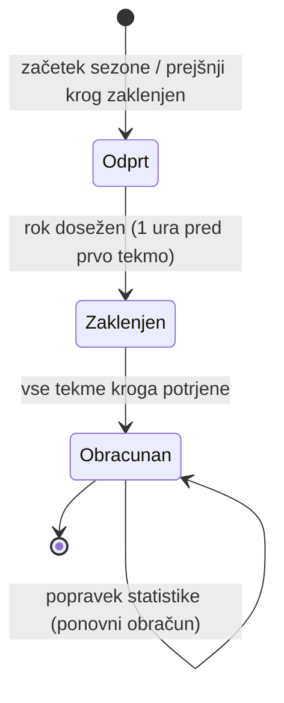
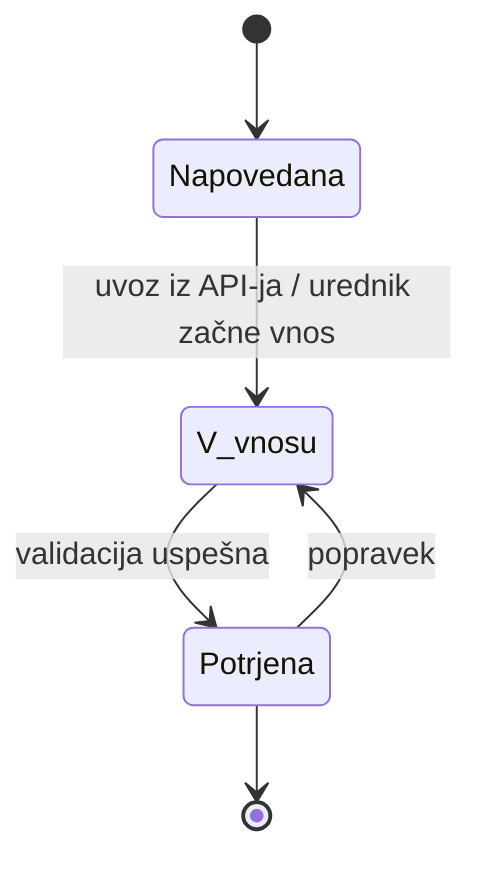

# 02 – Funkcionalnosti in obseg

## 1. Uporabniške vloge

### Menedžer

**Lahko:**
- sestavi svoje moštvo (15 nogometašev) in opravlja prestope,
- pred vsakim krogom izbere postavo, kapetana in vrstni red klopi,
- ustvari zasebno ligo, deli kodo povabila ali se pridruži drugim ligam,
- vidi točke svojega moštva, lestvice svojih lig in statistiko nogometašev,
- po zaklepu kroga vidi postave drugih članov svojih lig.

**Nima pravic:**
- spreminjati postave ali opravljati prestopov po roku kroga,
- videti postav drugih menedžerjev pred zaklepom kroga,
- vnašati statistike tekem ali spreminjati točk,
- videti lestvic lig, v katere ni včlanjen.

### Urednik statistike

**Lahko:**
- vnaša rezultate tekem in statistiko nastopov nogometašev,
- potrdi tekmo, kar sproži izračun točk,
- popravi statistiko že potrjene tekme (sistem točke izračuna znova),
- nogometašu nastavi status (poškodovan, kaznovan).

**Nima pravic:**
- imeti lastnega fantasy moštva (preprečitev navzkrižja interesov),
- spreminjati cen nogometašev in razporeda krogov,
- ročno vpisovati točk (točke se vedno izračunajo iz statistike).

### Administrator

**Lahko:**
- vnaša in ureja klube, nogometaše in cene ter razpored krogov in tekem,
- dodeli vlogo urednika in blokira uporabnike,
- briše neprimerna imena moštev in lig.

**Nima pravic:**
- spreminjati moštev in postav menedžerjev,
- ročno spreminjati točk,
- videti gesel uporabnikov (shranjena so le zgoščena).

---

## 2. Predvidene funkcionalnosti

Funkcionalnosti (označene z **MVP**), so del prve delujoče različice. Domensko specifične so označene z **[DS]**.

| # | Funkcionalnost | Opis | Vloga |
|---|---|---|---|
| 1 | **(MVP)** Prijava, registracija in vloge | Prijava z e-pošto in geslom. Registracija ustvari menedžerja, drugi vlogi dodeli administrator. | vsi |
| 2 | **(MVP)** Sestavljanje moštva z omejitvami **[DS]** | Izbira 15 nogometašev. Sistem preveri proračun (100 mio), razmerje 2/5/5/3 po pozicijah in največ 3 igralce iz istega kluba. | menedžer |
| 3 | **(MVP)** Postava kroga in zaklep ob roku **[DS]** | Izbira 11 začetnih igralcev v veljavni formaciji, kapetana in vrstnega reda klopi. Po roku kroga strežnik zavrne vsako spremembo. | menedžer |
| 4 | **(MVP)** Prestopi s kaznijo **[DS]** | Zamenjava igralca z drugim na isti poziciji. En prestop na krog je brezplačen, vsak dodatni stane 4 točke. | menedžer |
| 5 | **(MVP)** Vnos statistike in izračun točk **[DS]** | Urednik vnese rezultat in statistiko nastopov. Sistem preveri ujemanje golov z rezultatom in po potrditvi izračuna točke po pravilih točkovanja. | urednik |
| 6 | **(MVP)** Obračun kroga **[DS]** | Ko so potrjene vse tekme kroga, sistem izvede samodejne menjave, podvoji točke kapetana, odšteje kazni in zapiše rezultat moštva. | sistem |
| 7 | **(MVP)** Zasebne lige in lestvica | Ustvarjanje lige, pridružitev s kodo povabila, lestvica po skupnih točkah. | menedžer |
| 8 | Seznam in statistika nogometašev | Filtri po poziciji, klubu in ceni. Točke skupaj in forma zadnjih 5 krogov. | menedžer |
| 9 | Status nogometašev | Urednik označi poškodbo ali kazen, menedžer v postavi vidi opozorilo. | urednik, menedžer |
| 10 | Začasne točke med krogom | Po vsaki potrjeni tekmi menedžer vidi trenutne točke moštva in začasno lestvico. | menedžer |
| 11 | Popravek statistike **[DS]** | Urednik popravi potrjeno tekmo, sistem ponovno izračuna točke in obračun kroga. | urednik |
| 12 | Upravljanje klubov, nogometašev in razporeda | Vnos in urejanje klubov, nogometašev (pozicija, cena) ter krogov in tekem z roki. | administrator |
| 13 | Upravljanje uporabnikov | Dodeljevanje vloge urednika, blokada uporabnikov. | administrator |
| 14 | Samodejni uvoz statistike in sprotne točke **[DS]** | Med tekmami časovno opravilo vsakih 5 minut prenese statistiko iz zunanjega API-ja (API-Football) in posodobi točke nogometašev ter začasne lestvice. Urednik ob koncu tekme statistiko le preveri in potrdi. | sistem, urednik |
| 15 | E-poštni opomniki pred rokom | 24 ur pred rokom kroga sistem pošlje e-pošto menedžerjem, ki imajo v začetni postavi poškodovanega ali kaznovanega igralca ali postave za ta krog še niso shranili. | sistem, menedžer |

---

## 3. Ključni delovni proces: krog

Netrivialni delovni proces je **krog**, ki povezuje funkcionalnosti 3, 4, 5 in 6.

**Stanja kroga:**

**Stanja tekme:**

**Potek obračuna kroga** (za vsako moštvo):
1. Za vsakega začetnega igralca sistem preveri, ali je igral (minute > 0).
2. Igralca, ki ni igral, zamenja prvi igralec s klopi, ki je igral, če formacija ostane veljavna.
3. Točke kapetana se podvojijo (če kapetan ni igral, se ne podvoji nič).
4. Odštejejo se kazenske točke za dodatne prestope.
5. Zapiše se rezultat moštva v krogu, posodobijo se lestvice lig.

**Pravila igre:**

| Pravilo | Vrednost |
|---|---|
| Moštvo | 15 igralcev: 2 VR, 5 OB, 5 VE, 3 NA |
| Proračun | 100 mio |
| Največ iz istega kluba | 3 |
| Veljavna formacija | 1 VR, 3–5 OB, 2–5 VE, 1–3 NA (skupaj 11) |
| Rok za spremembe | 1 ura pred prvo tekmo kroga |
| Prestopi | 1 brezplačen na krog, vsak dodatni −4 točke |
| Kapetan | dvojne točke |

**Točkovanje:**

| Dogodek | VR / OB | VE | NA |
|---|---|---|---|
| igral do 59 min / 60+ min | 1 / 2 | 1 / 2 | 1 / 2 |
| gol | 6 | 5 | 4 |
| asistenca | 3 | 3 | 3 |
| čista mreža (60+ min) | 4 | 1 | 0 |
| rumeni / rdeči karton | −1 / −3 | −1 / −3 | −1 / −3 |
| avtogol | −2 | −2 | −2 |

---

## 4. Kasnejše nadgradnje

- **H2H lige:** vsak krog dvoboj dveh moštev, zmaga prinese 3 točke na lestvici.
- **Bonusi:** enkratne ugodnosti v sezoni, npr. »trojni kapetan« ali »neomejeni prestopi«.
- **Dinamične cene:** cena nogometaša se spreminja glede na število nakupov in prodaj.
- **Nastavljiva pravila točkovanja**, ki jih administrator spreminja brez posega v kodo.
- **Draft liga:** vsak nogometaš je lahko le v enem moštvu lige, igralce si člani na začetku sezone izbirajo po vrsti.

---

## 5. Izven obsega (Out of scope)

- Stave, vložki ali nagrade s pravim denarjem.
- Spremljanje tekem v živo (dogodki minuto za minuto, komentarji, prenosi).
- Uporaba grbov klubov in fotografij nogometašev (licence).
- Druge lige in več sezon hkrati (podprta je ena sezona Prve lige).
- Klepet in komentarji med člani lige.
- Izvorna mobilna aplikacija.
