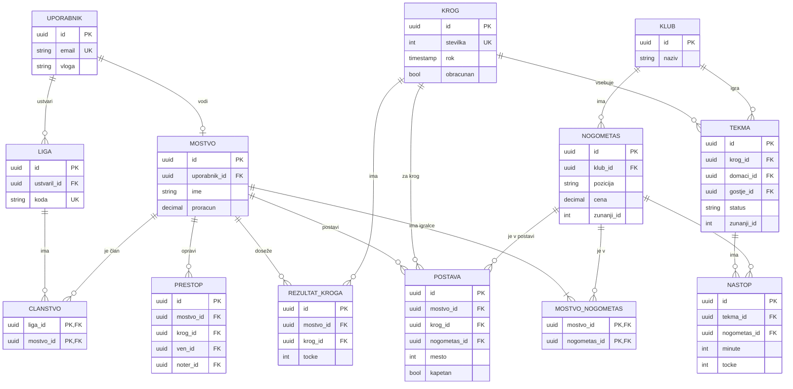

# 03 – Podatkovni model

Podatkovni model je relacijski. Podatki so močno povezani (klub &rarr; nogometaš &rarr; nastop na tekmi &rarr; točke &rarr; postave moštev &rarr; lige), prestopi in obračun kroga pa morajo spremeniti več tabel hkrati v eni transakciji. Imena tabel in polj so zapisana brez šumnikov (snake_case).

## 1. Pregled entitet

| Entiteta | Opis |
|---|---|
| `uporabnik` | uporabnik sistema (menedžer, urednik ali administrator), vloga je polje v tabeli |
| `klub` | klub Prve lige |
| `nogometas` | resnični nogometaš s pozicijo, ceno in statusom |
| `krog` | krog sezone z rokom za spremembe |
| `tekma` | tekma dveh klubov v krogu z rezultatom |
| `nastop` | statistika nogometaša na eni tekmi in izračunane točke |
| `mostvo` | fantasy moštvo menedžerja |
| `mostvo_nogometas` | vmesna tabela: 15 nogometašev v moštvu |
| `postava` | postava moštva za posamezen krog (en zapis na igralca) |
| `prestop` | zamenjava igralca v moštvu |
| `rezultat_kroga` | točke moštva v posameznem krogu |
| `liga` | zasebna liga s kodo povabila |
| `clanstvo` | vmesna tabela: moštva v ligi |

## 2. Diagram (ER)

## 3. Povezave med entitetami

- **Klub &rarr; Nogometaš: 1:N** (klub ima več nogometašev).
- **Krog &rarr; Tekma: 1:N** in **Klub &rarr; Tekma: 1:N** (tekma ima domači in gostujoči klub).
- **Tekma &harr; Nogometaš: N:M** prek `nastop` (statistika nogometaša na tekmi).
- **Uporabnik &rarr; Moštvo: 1:0..1** (menedžer ima eno moštvo, urednik in administrator nobenega).
- **Moštvo &harr; Nogometaš: N:M** prek `mostvo_nogometas` (moštvo ima 15 igralcev, igralec je lahko v več moštvih).
- **Moštvo &rarr; Postava: 1:N** (za vsak krog 15 zapisov, en na igralca).
- **Moštvo &rarr; Prestop: 1:N** in **Moštvo &rarr; Rezultat kroga: 1:N**.
- **Liga &harr; Moštvo: N:M** prek `clanstvo` (moštvo je lahko v več ligah).

## 4. Opis entitet in glavnih polj

### `uporabnik`

| Polje | Tip | Opis |
|---|---|---|
| `id` | UUID, PK | |
| `email` | VARCHAR, unikaten | uporablja se za prijavo |
| `ime` | VARCHAR | prikazno ime |
| `vloga` | ENUM (`menedzer`, `urednik`, `admin`) | določa pravice |
| `je_blokiran` | BOOLEAN | |

Gesla in seje hrani knjižnica Better Auth v svojih tabelah (`account`, `session`).

### `nogometas`

| Polje | Tip | Opis |
|---|---|---|
| `id` | UUID, PK | |
| `klub_id` | UUID, FK &rarr; `klub` | |
| `ime`, `priimek` | VARCHAR | |
| `pozicija` | ENUM (`VR`, `OB`, `VE`, `NA`) | vratar, branilec, vezist, napadalec |
| `cena` | NUMERIC(4,1) | v mio, npr. 7,5 |
| `status` | ENUM (`na_voljo`, `poskodovan`, `kaznovan`) | |
| `zunanji_id` | INT, unikaten, NULL | ID nogometaša v zunanjem API-ju (za samodejni uvoz statistike) |

### `krog` in `tekma`

| Polje | Tip | Opis |
|---|---|---|
| `krog.stevilka` | INT, unikaten | 1–36 |
| `krog.rok` | TIMESTAMP | rok za spremembe postav |
| `krog.obracunan` | BOOLEAN | `true`, ko je obračun izveden |
| `tekma.krog_id` | UUID, FK &rarr; `krog` | |
| `tekma.domaci_id`, `tekma.gostje_id` | UUID, FK &rarr; `klub` | |
| `tekma.goli_domaci`, `tekma.goli_gostje` | INT, NULL | prazno, dokler ni vneseno |
| `tekma.status` | ENUM (`napovedana`, `v_vnosu`, `potrjena`) | |
| `tekma.zunanji_id` | INT, unikaten, NULL | ID tekme v zunanjem API-ju |

### `nastop`

| Polje | Tip | Opis |
|---|---|---|
| `tekma_id` | UUID, FK &rarr; `tekma` | |
| `nogometas_id` | UUID, FK &rarr; `nogometas` | |
| `minute` | INT | 0–120 |
| `goli`, `asistence`, `avtogoli` | INT | |
| `rumeni`, `rdeci` | INT | |
| `tocke` | INT | izračuna sistem ob potrditvi tekme |

### `mostvo`

| Polje | Tip | Opis |
|---|---|---|
| `uporabnik_id` | UUID, FK &rarr; `uporabnik`, unikaten | |
| `ime` | VARCHAR | |
| `proracun` | NUMERIC(4,1) | preostanek proračuna |
| `skupne_tocke` | INT | vsota vseh rezultatov krogov |

### `postava`

| Polje | Tip | Opis |
|---|---|---|
| `mostvo_id`, `krog_id`, `nogometas_id` | UUID, FK | |
| `mesto` | INT | 1–11 začetna postava, 12–15 klop po vrstnem redu menjav |
| `kapetan` | BOOLEAN | |
| `tocke` | INT, NULL | izpolni obračun (po menjavah in kapetanu) |

### `prestop`, `rezultat_kroga`, `liga`, `clanstvo`

| Polje | Tip | Opis |
|---|---|---|
| `prestop.ven_id`, `prestop.noter_id` | UUID, FK → `nogometas` | igralec ven in igralec noter |
| `prestop.brezplacen` | BOOLEAN | `false` pomeni −4 točke ob obračunu |
| `rezultat_kroga.tocke` | INT | točke moštva v krogu (po kazni) |
| `rezultat_kroga.kazen` | INT | kazenske točke za prestope |
| `liga.ime` | VARCHAR | |
| `liga.koda` | VARCHAR, unikaten | koda povabila, 8 znakov |
| `liga.ustvaril_id` | UUID, FK → `uporabnik` | ustvarjalec lige |
| `clanstvo.liga_id`, `clanstvo.mostvo_id` | UUID, FK | sestavljeni ključ |

## 5. Omejitve

- **En nastop nogometaša na tekmo:** unikatna omejitev na (`tekma_id`, `nogometas_id`).
- **Ena postava na igralca v krogu:** unikatni omejitvi na (`mostvo_id`, `krog_id`, `nogometas_id`) in (`mostvo_id`, `krog_id`, `mesto`).
- **En rezultat moštva na krog:** unikatna omejitev na (`mostvo_id`, `krog_id`).
- **Preverjanje vrednosti:** `minute` med 0 in 120, `proracun` ≥ 0, `mesto` med 1 in 15.
- **Pravila v aplikaciji:** razmerje 2/5/5/3, največ 3 iz kluba, veljavna formacija in rok kroga preverja strežnik.
- **Transakcije:** prestop (moštvo, proračun, postava) in obračun kroga se izvedeta v eni transakciji.
