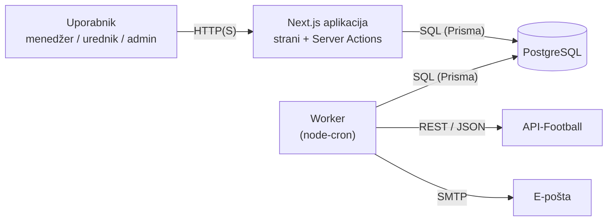

# 04 – Arhitektura in tehnološki sklad

## 1. Arhitektura

### Glavni deli sistema

| Del | Naloga |
|---|---|
| **Spletna aplikacija (Next.js)** | uporabniški vmesnik za vse tri vloge in strežniška logika (pravila igre, izračun točk, obračun kroga, avtentikacija) |
| **Worker (časovna opravila)** | ločen proces Node.js, ki med tekmami uvaža statistiko iz zunanjega API-ja in pošilja e-poštne opomnike pred rokom |
| **Podatkovna baza (PostgreSQL)** | trajna hramba vseh podatkov (uporabniki, nogometaši, tekme, moštva, postave, lige) |
| **Zunanji storitvi** | API-Football (statistika tekem) in SMTP strežnik (pošiljanje e-pošte) |

Frontend in backend nista ločena: Next.js strani upodobi na strežniku, spremembe pa izvede s **Server Actions** (strežniške funkcije, ki jih kliče obrazec ali gumb). Next.js aplikacija je v mapi `frontend/`, poslovna logika, dostop do baze in worker pa v mapi `backend/`. Poslovno logiko uporabljata tako aplikacija kot worker.

### Diagram

### Komunikacija med deli

- **Brskalnik → Next.js:** strani se upodobijo na strežniku. Obrazci (postava, prestop, potrditev tekme) kličejo Server Actions, ki se pošljejo kot zahtevki POST. Ločenega REST API-ja ni.
- **Next.js / Worker → Baza:** poizvedbe prek Prisme. Operacije, ki spremenijo več tabel hkrati (prestop, potrditev tekme, obračun kroga), se izvedejo v eni transakciji.
- **Worker → API-Football:** med tekmami vsakih 5 minut prenese statistiko tekem, ki potekajo, in posodobi nastope in točke. Nogometaši in tekme so z API-jem povezani prek polja `zunanji_id`.
- **Worker → SMTP:** enkrat na uro preveri, ali ima kateri krog rok čez 24 ur, in pošlje opomnike menedžerjem.

### Podatkovna baza

- Relacijska baza **PostgreSQL** z modelom iz `03-podatkovni-model.md`.
- Shema je opisana v `schema.prisma`, spremembe sheme se izvajajo s Prisma Migrate.
- Lokalno teče baza v **Dockerju**, aplikacija in worker se z njo povežeta prek spremenljivke `DATABASE_URL`.

### Avtentikacija in upravljanje uporabnikov

- Prijava z **e-pošto in geslom** prek knjižnice **Better Auth**. Gesla so shranjena samo zgoščena.
- Po prijavi se ustvari **seja**, shranjena v bazi. Brskalnik ima le piškotek `httpOnly`. Ob blokadi uporabnika se seja izbriše.
- Vsaka Server Action najprej preveri prijavo in **vlogo** uporabnika.
- Registracija ustvari račun z vlogo *menedžer*. Vlogi *urednik* in *administrator* dodeli administrator.

### Lokalni zagon (macOS)

Potrebno: Node.js (LTS), pnpm in Docker Desktop.

1. Kopiraj `.env.example` v `.env` in nastavi `DATABASE_URL`, `BETTER_AUTH_SECRET`, `API_FOOTBALL_KEY` in `SMTP_URL`.
2. `docker compose up -d` zažene PostgreSQL in Mailpit (lokalni SMTP, ki e-pošto le prikaže na `http://localhost:8025`).
3. `pnpm install`, nato `pnpm prisma migrate dev` (ustvari tabele) in `pnpm prisma db seed` (testni podatki).
4. `pnpm dev` zažene aplikacijo na `http://localhost:3000`, `pnpm worker` pa v drugem terminalu zažene časovna opravila.

## 2. Tehnološki sklad

| Področje | Izbira |
|---|---|
| Frontend | Next.js (App Router), React, TypeScript, Tailwind CSS |
| Backend | Next.js Server Actions (Node.js), TypeScript |
| Časovna opravila | Node.js proces z `node-cron` |
| Podatkovna baza | PostgreSQL (`postgres:17-alpine` v Dockerju) |
| Dostop do baze | Prisma ORM, Prisma Migrate |
| Avtentikacija | Better Auth (e-pošta in geslo, seje v bazi) |
| Zunanji podatki | API-Football (REST API) |
| E-pošta | Nodemailer, lokalno Mailpit |
| Lokalni razvoj | macOS, Docker Desktop, Node.js in pnpm, Git in GitHub |

## 3. Arhitekturne odločitve

| Odločitev | Utemeljitev |
|---|---|
| **Next.js za frontend in backend** | En projekt, en jezik in en zagon. Ker ima aplikacija le enega odjemalca (spletni vmesnik), ločen REST API ni potreben. |
| **Server Actions namesto REST API-ja** | Obrazec neposredno pokliče strežniško funkcijo, zato ni treba pisati končnih točk in klicev `fetch`. |
| **Poslovna logika v mapi `backend/`** | Pravila igre so na enem mestu, ločeno od komponent, in jih lahko uporablja tudi worker. |
| **Ločen worker za časovna opravila** | Next.js nima vgrajenih časovnih opravil. Uvoz statistike in pošiljanje e-pošte tečeta neodvisno od zahtevkov uporabnikov in ne upočasnjujeta aplikacije. |
| **PostgreSQL** | Podatki so močno povezani, prestopi in obračun pa zahtevajo tuje ključe, omejitve in transakcije. |
| **Prisma** | Tipsko varen dostop do baze, shema in migracije na enem mestu, podpora transakcijam. |
| **Better Auth s sejami v bazi** | Preizkušena knjižnica za prijavo z e-pošto in geslom, ki deluje s Prismo. Seje v bazi omogočajo takojšnjo odjavo blokiranega uporabnika. |
| **Docker za bazo in e-pošto** | Enako okolje na vsakem računalniku, zagon z enim ukazom. Mailpit omogoča preizkus e-pošte brez pravega pošiljanja. |

Podrobnejša utemeljitev posameznih odločitev je v [`docs/adr/`](adr/).
