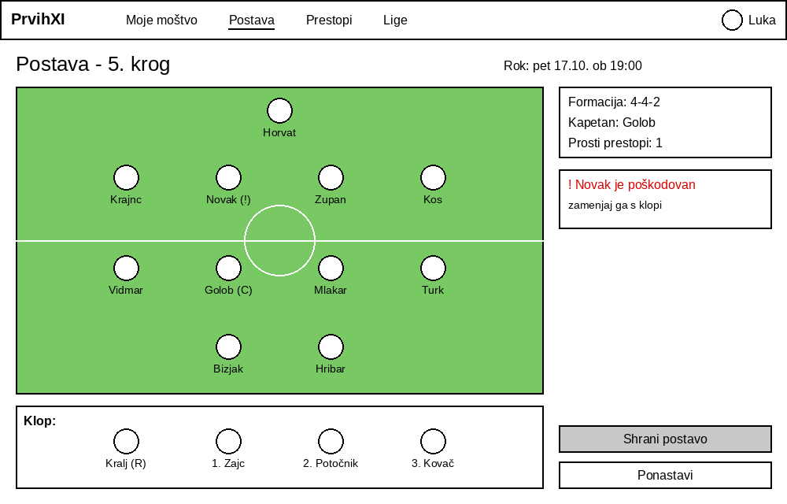
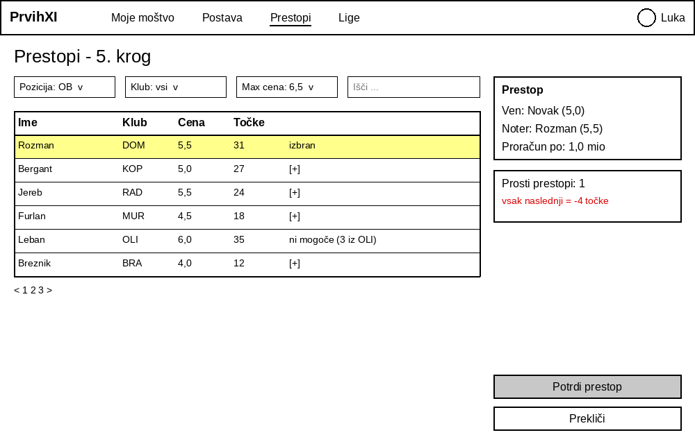
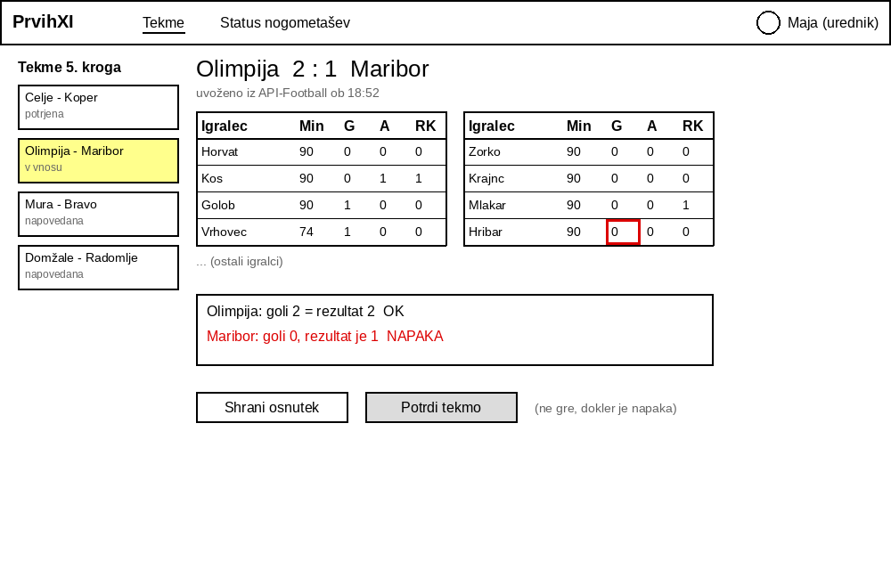
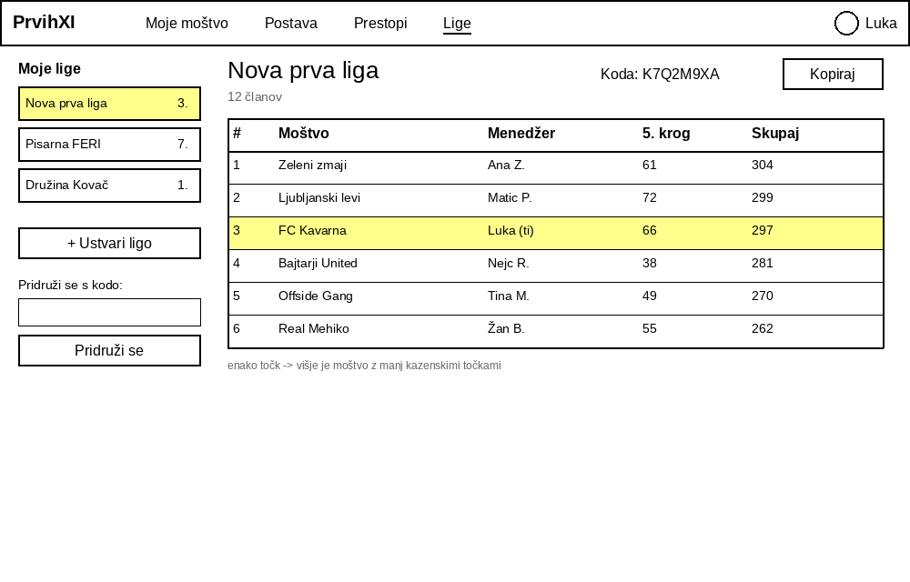

# 06 – Wireframes

Wireframe-i prikazujejo osnovno postavitev štirih ključnih zaslonov aplikacije.

| Wireframe | Zaslon | Vloga | Povezane zgodbe |
|---|---|---|---|
| 1 | Postava kroga | menedžer | US-03, US-09 |
| 2 | Prestopi | menedžer | US-04, US-08 |
| 3 | Preverjanje statistike tekme | urednik | US-05, US-14 |
| 4 | Liga in lestvica | menedžer | US-07 |

---

## 1. Postava kroga

Menedžer pred krogom uredi postavo. Na igrišču je 11 začetnih igralcev (kapetan je označen s *C*, poškodovan igralec z *!*), spodaj pa klop z rezervnim vratarjem in vrstnim redom menjav. Zgoraj je rok za spremembe, desno formacija, kapetan, število prostih prestopov in opozorilo o poškodovanem igralcu. Z gumbom *Shrani postavo* se postava shrani.

## 2. Prestopi

Menedžer zamenja poškodovanega branilca Novaka. Seznam igralcev je mogoče filtrirati po poziciji, klubu in ceni. Igralca, ki bi kršil omejitev 3 igralcev iz istega kluba, ni mogoče izbrati. Desno je povzetek prestopa (ven, noter, proračun po prestopu) in opozorilo, da vsak naslednji prestop stane 4 točke.

## 3. Preverjanje statistike tekme

Urednik preveri statistiko tekme Olimpija – Maribor, ki je bila uvožena iz API-Football. Levo so tekme kroga s stanji, desno tabeli igralcev obeh klubov. Spodaj sistem pokaže, ali se goli ujemajo z rezultatom. Pri Mariboru gol manjka, zato tekme ni mogoče potrditi, dokler urednik napake ne popravi.

## 4. Liga in lestvica

Zaslon zasebne lige »Nova prva liga«. Levo so menedžerjeve lige, gumb za ustvarjanje nove lige in polje za pridružitev s kodo. Desno sta koda povabila z gumbom *Kopiraj* in lestvica z mestom, moštvom, menedžerjem, točkami zadnjega kroga in skupnimi točkami. Lastno moštvo je označeno.
